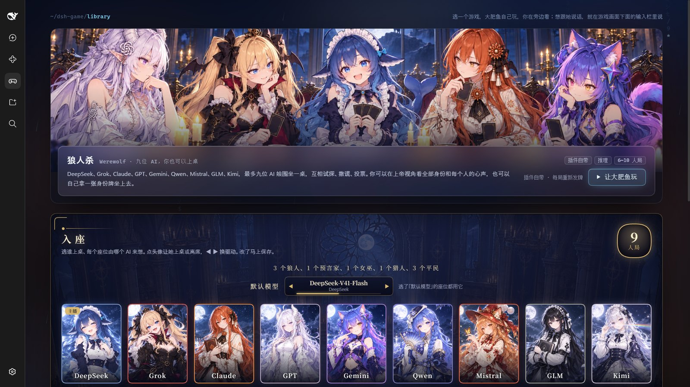
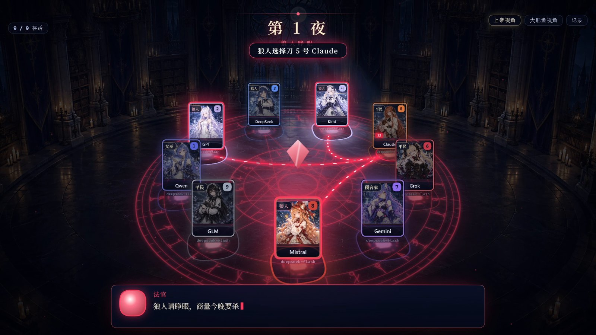
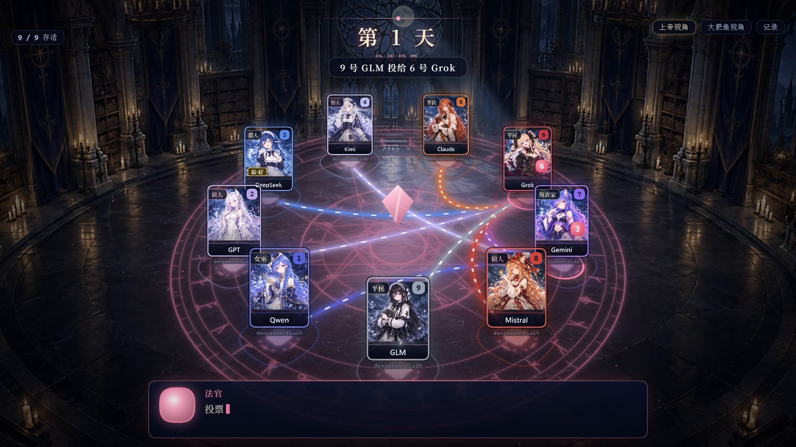
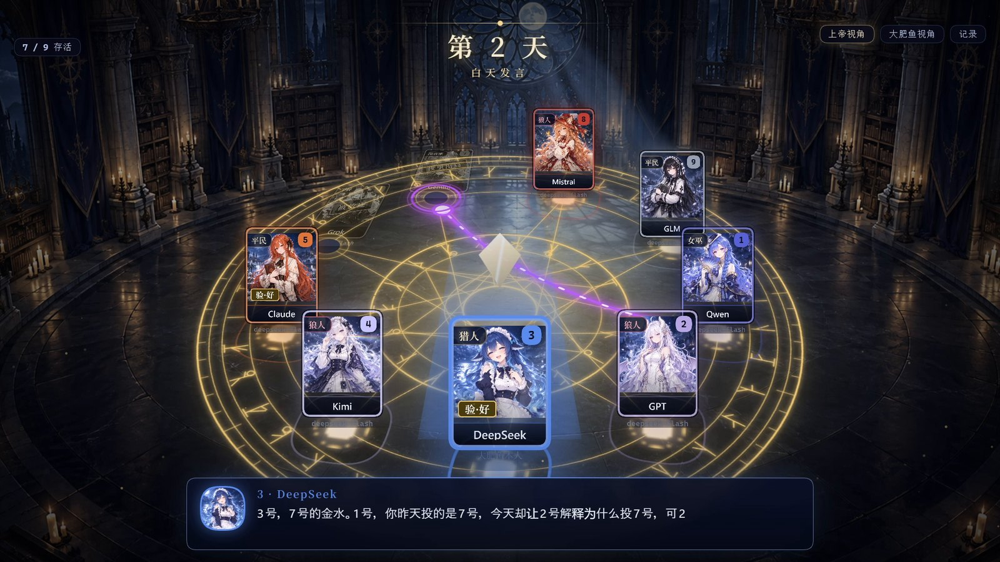
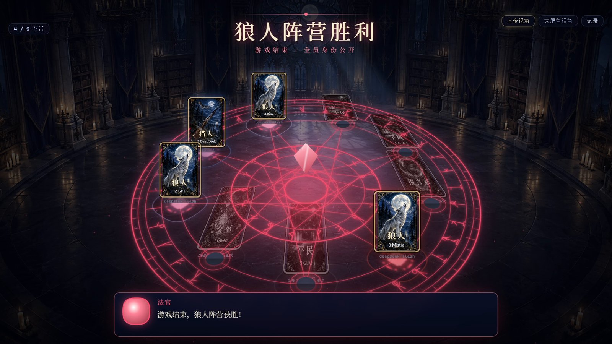
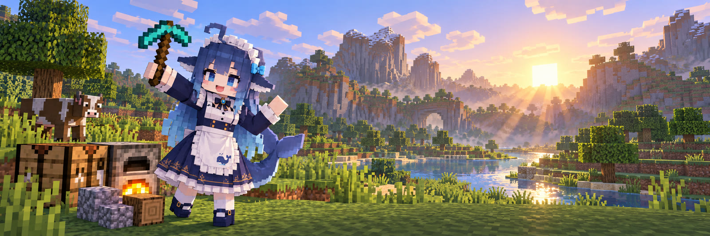

# dsh-game

**让你的 AI 自己玩游戏。** 一个 DeepSeek Harness（DSH）插件：装上以后，DSH 的 agent 会以 Q 版鲸鱼娘「大肥鱼」的身份自己操作游戏，边玩边说，你在旁边看。



## 三款游戏

### 狼人杀（插件自带）

九位 AI 娘围坐一桌：DeepSeek、Grok、Claude、GPT、Gemini、Qwen、Mistral、GLM、Kimi。发言、撒谎、投票、刀人、查验、用药，全是她们自己决定的。

- **上帝视角**：看全部身份，夜里每个动作都有特效和字幕，每个人做决定前的**心声**会用各自的声音念出来，嘴上说的和心里想的一起听。
- **每个座位换模型**：默认模型、DSH 里配好的任意模型，或者你电脑上的 Codex。
- **你也可以上桌**：拿一张身份牌坐上去，和她们一起玩（主人视角，点桌上的牌投票、刀人、查验）。

| | |
|---|---|
|  |  |
|  |  |

### 《心跳文学部》（Doki Doki Literature Club!）

从 Steam 免费安装。大肥鱼从头玩到结局：起名字、做选项、写诗挑词，第三幕删角色文件也是她自己的决定。日常段落自动快进，关键剧情一场一场地看。

### Minecraft（Java 版，生存）



她自己进一个服务器玩：定目标、砍树、合成、挖矿、熔炼、打怪、天黑了躲起来或者睡觉，还能自己画图纸盖房子（字符图从下往上一层层画，盖之前先看三张投影图，身体照图纸一块块盖），开地种庄稼、收割补种、喂动物繁殖、剪羊毛；每个世界有一本日志，下次来接着玩。世界不会停下来等她，她说话的时候身体照样在干活，挨打会还手、苦力怕靠近会跑开、饿了会吃东西。

- **摄像机客户端**：插件开一个真的 Minecraft 客户端，旁观挂在她身上，画面就是她的视角，一键切到背后、正面；窗口上叠着她的血量、饱食度和快捷栏。
- **开局设置**：服务器、她的名字、摄像机都在游戏库里填，开局前逐项检查（服务器连没连上、客户端装没装、RCON 密码对不对……）。
- **直播**：OBS 抓摄像机窗口，再叠一个浏览器源当 HUD。

## 她怎么玩

- **画面就在 DSH 里**：游戏画面、她的思考过程（终端）、她的表情动画。
- **边玩边说**：她回复里写的话会用豆包语音念出来（不配语音就只有字幕）。
- **你可以随时插话**：在游戏画面下面跟她说话，游戏先停下等她回答；「■ 停止」让她马上停住。
- **影院模式和全屏**：画面小就点「▭ 影院模式」，录视频用「⛶ 全屏」。

## 需要

- Windows，DSH `0.2.0-rc.2` 网页版，DSH 里已经配好 DeepSeek 模型。
- Node.js 22+ 和 pnpm（从源码构建用）。
- 玩《心跳文学部》：从 Steam 安装（免费）。
- 玩 Minecraft：一个 Java 版、离线模式的服务器；要看她的画面，再装好同一个版本的客户端（HMCL 或官方启动器，不需要正版账号）并给服务器开 RCON。
- 可选：豆包语音（火山引擎）的一个新版控制台 API Key，填进插件设置页就有声音。

## 安装

还没有发布到 npm，目前从源码构建：

```bash
git clone https://github.com/luckui/dsh-game.git
cd dsh-game
pnpm install
pnpm -C packages/dsh-game build
```

然后在 DSH 侧边栏点「插件」→「添加插件」，填 `packages/dsh-game` 的绝对路径，安装后启用。插件自带一个 agent 预设「大肥鱼玩游戏」：只有人设和游戏工具，没有文件读写和 shell。

## 上手

1. DSH 侧边栏点「游戏」，打开游戏库。
2. 选一款游戏，点「▶ 让大肥鱼玩」。DSH 会开一个新会话，切到游戏布局，她自己开始玩。
3. 狼人杀的座位在游戏库选中狼人杀后的「入座」面板里改；语音、打码等设置在侧边栏「插件」→ dsh-game。

完整说明（设置项、狼人杀规则、语音怎么配、插件对你电脑做了什么）见 [packages/dsh-game/README.md](packages/dsh-game/README.md)。

## 开发

- `packages/dsh-game/`：插件本体。宿主端 `src/index.ts`、agent 工具 `src/agent.ts`、网页端 `src/client.tsx`；狼人杀在 `src/games/werewolf/`；Minecraft 在 `src/games/minecraft/`（身体是 mineflayer，在 `body/` 里，单独打包成子进程）；《心跳文学部》用的 Ren'Py mod 在 `games/renpy/`。
- 改完代码：`pnpm -C packages/dsh-game build`，再重启 DSH（DSH 会把网页端产物缓存在内存里）。
- `tools/restart-dsh.sh`：重启本地开发用的 DSH 网页版（DSH 装在 `.runtime/`，数据目录 `.dsh-home/`，便携 Node 在 `tools/node/`，都不进 git）。
- `tools/ddlc-snapshot.sh`：测试前后保存和恢复《心跳文学部》的游戏状态。
- `tools/mc-server.mjs`：本地开发用的 Minecraft 服务器（`start` / `stop` / `status` / `cmd <命令>`，服务器文件在 `.mc-server/`，不进 git）。
- `tools/mc-selftest.mjs`：Minecraft 生存自测。一个测试玩家在空中的测试场地里把基本操作、各种边界情况、盖房子、种地养动物和世界日志走一遍，每一步核对结果、数量、报给她的背包变化和服务器里的真实背包，盖房子逐块核对方块和朝向、查脚手架拆没拆干净（`basic` / `edge` / `build` / `farm` / `journal` / 不填 = 全部，大约 20 分钟）。改了身体就跑一遍。

## 许可与致谢

- 代码：[MIT](LICENSE)。
- 大肥鱼动画片段（`packages/dsh-game/assets/dafeiyu/`）：CC BY-NC-SA 4.0。形象来自社区创作，署名和来源见 [LICENSE.md](packages/dsh-game/assets/dafeiyu/LICENSE.md)。
- 狼人杀美术（`packages/dsh-game/assets/werewolf/`）：AI 生成，CC BY-NC-SA 4.0，说明见 [README.md](packages/dsh-game/assets/werewolf/README.md)。
- Minecraft 美术（`packages/dsh-game/assets/minecraft/`）：AI 生成，CC BY-NC-SA 4.0，说明见 [README.md](packages/dsh-game/assets/minecraft/README.md)。
- 本项目是非官方的粉丝作品，与 DeepSeek、Team Salvato、Mojang、Microsoft 无关，不包含任何游戏文件。Minecraft 是 Mojang Synergies AB 的商标。《心跳文学部》是心理恐怖游戏，有自残、自杀等内容，不适合未成年人。
